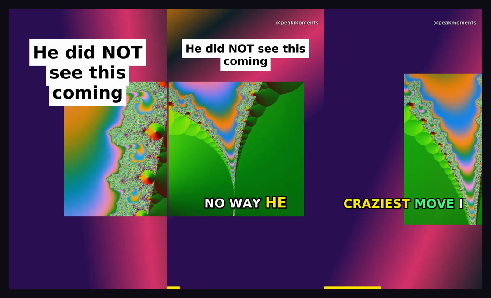
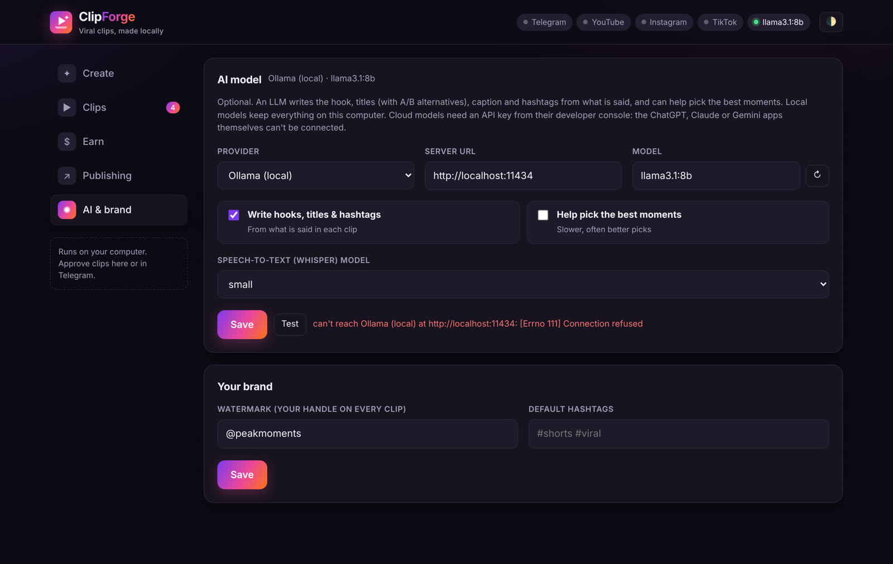

<h1 align="center">ClipForge</h1>
<p align="center"><b>Turn any video into viral short clips, on your own computer, for free.</b></p>

<p align="center"></p>

Paste a video link, upload a file or follow a live stream. ClipForge finds the most exciting moments, cuts them into Shorts / Reels / TikToks with word-by-word captions, a hook title, jump cuts, zoom punch-ins, a progress bar and a cover image, and scores how viral each one looks. You review them in the web app or in Telegram, and approved clips are posted to YouTube, Instagram and TikTok, now or on a schedule.

Everything runs on your computer: speech-to-text with Whisper, and the AI writer with Ollama or any cloud model you choose. No subscriptions.

> Screenshots in this README use generated demo footage, not real content.

## Contents

1. [Features](#features)
2. [Install](#1-install)
3. [Start and stop](#2-start-and-stop)
4. [Using the app](#3-using-the-app)
5. [Telegram bot: set up and link to the app](#4-telegram-bot-set-up-and-link-to-the-app)
6. [Using the bot](#5-using-the-bot)
7. [AI writer (optional)](#6-ai-writer-optional)
8. [Connect YouTube, Instagram and TikTok](#7-connect-youtube-instagram-and-tiktok)
9. [Earn from clipping](#8-earn-from-clipping)
10. [Commands](#9-commands)
11. [Settings (.env)](#10-settings-env)
12. [Updating](#updating) · [Troubleshooting](#troubleshooting) · [Server / Docker](#run-on-a-server-docker) · [Tests](#tests)

---

## Features

| | |
|---|---|
| **Sources** | Video links (YouTube, Twitch, Kick, TikTok, X, Instagram, Reddit, direct .mp4/.m3u8), uploaded files, and live streams (clips are cut while the stream is still running) |
| **Shapes** | Vertical 9:16, portrait 4:5, square 1:1 and landscape 16:9, in any mix per job |
| **Finding moments** | Audio excitement plus on-screen motion, optionally re-ranked by the AI from what is said |
| **Viral look** | Pop captions (the spoken word in yellow, key words in green), a hook title for the first 3 s, jump cuts (only real dead air, never silent action), zoom punch-ins, a progress bar and your watermark |
| **Smart crop** | Follows faces (streamer cam, podcast guests) and action instead of always cropping the centre |
| **Cover image** | Made for every clip and used as its first frame, so YouTube, Instagram and TikTok all show it as the thumbnail |
| **AI writer** | Hook, title, caption, hashtags and a virality score, plus alternative hooks and titles to choose from |
| **Edit before posting** | Change the title, hook, caption or cover in the app or with buttons in Telegram |
| **Copyright check** | Gives each link, live stream and upload a risk level, says whether the original is likely monetised, and suggests what to do |
| **Publishing** | YouTube (Shorts or normal videos), Instagram Reels and TikTok, posted now or on a schedule |
| **Earn** | Tracks paid clipping campaigns (Whop Content Rewards, Vyro, ClipAffiliates, Promote.fun, direct deals). Adds the required hashtags, keeps post links ready to submit, and estimates earnings |

<p align="center"><br>
<sub>A finished vertical clip: the cover as the first frame, then the hook, pop captions, @watermark and progress bar.</sub></p>

---

## 1. Install

### Mac

You need a Mac (Apple Silicon or Intel), about 5 GB of free space, and [Homebrew](https://brew.sh).

```bash
# 1. Tools. ffmpeg-full includes libass, which captions need.
brew install ffmpeg-full python@3.12 git
brew link --force ffmpeg-full
ffmpeg -filters | grep " ass "        # must print a line, otherwise captions are skipped

# 2. Get ClipForge
git clone https://github.com/amitkumarsingh1697/ClipForge.git
cd ClipForge

# 3. Python environment
python3.12 -m venv .venv
source .venv/bin/activate
pip install -r requirements.txt

# 4. Your settings file
cp .env.example .env
```

### Windows / Linux

Install Python 3.12, git and ffmpeg built with libass (most Linux packages have it; on Windows use a "full" build from gyan.dev and add it to PATH). Then run steps 2 to 4 above. On Windows, activate the environment with `.venv\Scripts\activate`.

---

## 2. Start and stop

```bash
cd ClipForge
source .venv/bin/activate
python -m app.cli serve
```

Your browser opens **http://127.0.0.1:8000**. The first clip downloads the Whisper speech model (~500 MB), so it takes a few minutes; later clips are faster.

**Keep it running in the background** (it keeps running after you close Terminal):

```bash
nohup python -m app.cli serve > data/serve.log 2>&1 &
```

**Stop it:**

```bash
pkill -f "app.cli serve"
```

**See what it's doing:** `tail -f data/serve.log`

---

## 3. Using the app

The sidebar has five pages: **Create**, **Clips**, **Earn**, **Publishing** and **AI & brand**. The dot next to each name at the top turns green when that service is connected.

### Create clips

<p align="center"></p>

1. **Source:** paste a link, or switch to **Upload** (a file from your computer) or **Live stream** (a Twitch, Kick or YouTube live channel).
   Press **🛡 Check copyright** to see who owns the video and how risky it is to repost.
2. **Shape:** pick one or more shapes. You get one clip per moment for each shape.
3. **Clips per video** and **Clip length** (up to 5 min; Shorts count only up to 3 min). **Title** is optional.
4. **Style:** caption style, an optional **Campaign** (see [Earn](#8-earn-from-clipping)), and the extras:
   - **Hook title:** big curiosity text for the first 3 seconds
   - **Jump cuts:** removes pauses in talking (never silent action scenes, at most 25% of a clip)
   - **Zoom punch-ins:** quick zooms on key words
   - **Progress bar** along the bottom
   - **Cover as first frame:** makes the cover the thumbnail everywhere
5. Press **✦ Make clips** (or **● Start recording** for a live stream; press **■ Stop recording** on the job to end it).

### Review, edit and approve

On **Clips**, each video you submitted is a group with its copyright badge, and each clip card shows the cover, the 🔥 virality score, the hook, hashtags and details (length, cuts, zooms, campaign). Use the filter at the top to show only *Ready for review*, *Scheduled*, *Published* or *Failed*.

| Button | What it does |
|---|---|
| **✓ Approve** | Opens the publish dialog: **Publish now**, or pick a time (or a quick choice such as *Tonight 7 PM*) and **Schedule** |
| **Reject** | Deletes the clip |
| **✎ Edit** | Change the title, hook, caption or cover (see below) |
| **⬇ Video / ⬇ Cover** | Download the MP4 or the cover JPG |
| **↻ Remake** | Make the clip again with a fresh AI hook, title and caption |
| **Retry** | On a failed clip: render again, or publish again to the platforms that failed |

<p align="center"> </p>

**Edit:** tap one of the AI's alternative titles or hooks, or type your own. For the cover, write different text, slide to the moment you want, upload your own image, or go back to the automatic cover. A changed title or caption is saved straight away; a changed hook or cover re-makes the clip in about a minute.

If no account is connected, **Approve** just marks the clip approved, and you download it and post it yourself.

The app works on a phone too (open it on your network, or use Telegram):

<p align="center"></p>

---

## 4. Telegram bot: set up and link to the app

The bot sends you every finished clip with buttons to approve, reject or edit it, and you can send it links to clip from your phone. It talks to the ClipForge running on your computer and needs no public address, so it works on home Wi-Fi.

**Step 1: create the bot**

1. In Telegram, search for **@BotFather** (the official one, with a blue tick) and open it.
2. Send `/newbot`.
3. Send a display name, e.g. `My Clips`.
4. Send a username ending in `bot`, e.g. `myclips1234_bot`.
5. BotFather replies with a **token** like `1234567890:AAH...`. Copy it and keep it private: anyone with it controls the bot.

**Step 2: put the token in ClipForge**

Open the `.env` file in the ClipForge folder (e.g. `open -e .env` on a Mac) and set:

```
TELEGRAM_BOT_TOKEN=1234567890:AAH...your token...
```

**Step 3: link the bot to you**

Stop ClipForge first if it's running (otherwise it would read your message before the setup does):

```bash
pkill -f "app.cli serve"
python -m app.cli telegram-setup
```

It prints `Bot OK: @yourbot. Open https://t.me/yourbot and send it /start ...`. Open that link, press **Start** (or send `/start`) within 5 minutes. The bot answers *✅ Connected*, and your chat id is saved to `.env` as `TELEGRAM_OWNER_CHAT_ID`. From now on the bot only listens to you; messages from anyone else are ignored.

**Step 4: start ClipForge again**

```bash
nohup python -m app.cli serve > data/serve.log 2>&1 &
```

The log shows `Telegram bot is listening`, and the **Telegram** dot in the app turns green.

**Change or reset the bot:** in @BotFather send `/revoke` to get a new token (do this if the token was ever shared), put it in `.env` and restart. To link a different Telegram account, run `telegram-setup` again from that account.

---

## 5. Using the bot

```
You:  https://youtu.be/abc123 landscape square
Bot:  Queued https://youtu.be/abc123 (landscape, square) as job 3f9c1a2b7d10.
      I'll send clips here for approval.

Bot:  [video] [cover image]
      🔥 Virality 88/100
      🪝 He did NOT see this coming
      The Craziest Move Ever 😱
      Would you have tried this? 👇
      #gaming #clutch #viral
      32s vertical clip
      🟡 Copyright risk: medium (original is probably monetised)
      [✅ Approve & Publish] [❌ Reject & Delete]
      [✏️ Title] [🪝 Hook] [🖼 Cover]
```

| You send / tap | What happens |
|---|---|
| A video or live link | Clips are made. Add shape words to choose shapes: `vertical`, `portrait`, `square`, `landscape` (default: the app's default) |
| `/check https://...` | Copyright and monetisation check before you clip |
| `/help` | Shows these commands |
| **✅ Approve & Publish** | Posts to every connected account (or marks it approved if none are connected) |
| **❌ Reject & Delete** | Deletes the clip |
| **✏️ Title** | Shows the AI's alternative titles: tap one, or type your own |
| **🪝 Hook** | Same for the hook; send `none` to remove it. The clip is re-made and sent again |
| **🖼 Cover** | Send a **photo** to use as the cover, a **number** (e.g. `12`) to use that second of the clip, or **text** to write on it. Or tap *Back to automatic cover* |

You also get messages when a clip is published (with links, and a reminder to submit them to your campaign), when something fails, and when a source looks high-risk for copyright.

Clips over ~48 MB are sent as a smaller preview, because Telegram bots can send at most 50 MB; the full-quality file is what gets published.

---

## 6. AI writer (optional)

Clips work without any AI. With one, ClipForge writes the hook, title (plus alternatives), caption, hashtags and highlighted key words from what is said, and can help pick the best moments.

<p align="center"></p>

**Local and free (recommended):**

```bash
brew install ollama && brew services start ollama
ollama pull llama3.1:8b          # ~5 GB; on 8 GB Macs use llama3.2:3b
```

Then go to **AI & brand**, set Provider to **Ollama (local)**, pick the model, and press **Save**, then **Test**. LM Studio, llama.cpp, Jan, vLLM and LocalAI work too.

**Cloud models** need an API key from the provider's developer site. The ChatGPT, Claude and Gemini chat apps can't be connected directly.

| Provider | Get a key | Notes |
|---|---|---|
| Claude (Anthropic) | console.anthropic.com | |
| ChatGPT (OpenAI) | platform.openai.com/api-keys | |
| Gemini (Google) | aistudio.google.com/apikey | has a free tier |
| Kimi (Moonshot) | platform.moonshot.ai | |
| DeepSeek, Groq, OpenRouter, Mistral | their developer consoles | Groq and OpenRouter have free options |

Each provider keeps its own key, so you can switch back and forth. Under **Your brand**, set a **watermark** (your @handle on every clip) and **default hashtags**. **Speech-to-text model:** `small` is a good default; `medium` or `large-v3` are more accurate but slower.

---

## 7. Connect YouTube, Instagram and TikTok

<p align="center"></p>

### YouTube

1. In [Google Cloud Console](https://console.cloud.google.com/projectcreate), create a project (it's free).
2. Enable **[YouTube Data API v3](https://console.cloud.google.com/apis/library/youtube.googleapis.com)**.
3. Open **Google Auth Platform** (the OAuth consent screen). Choose External, enter an app name and your email, add your Google account as a test user, then press **Publish app** (In production). In Testing mode, sign-in expires every 7 days.
4. Go to **Credentials → Create credentials → OAuth client ID → Desktop app** and download the JSON file.
5. In ClipForge, open **Publishing**, upload the JSON, press **Connect YouTube**, sign in and allow access. If Google says the app is unverified, choose Advanced → continue; it's your own app.

New Google projects can only post **private** videos until Google audits them; you can make them public in YouTube Studio. Clips up to 3 min that aren't landscape are posted as Shorts. The free quota allows about 6 uploads a day.

### Instagram Reels

1. Switch your Instagram to a **Professional** (Business or Creator) account and link it to a Facebook Page.
2. Create an app at [Meta for Developers](https://developers.facebook.com/apps) and add the Instagram product.
3. Generate a long-lived access token with `instagram_basic`, `instagram_content_publish` and `pages_show_list`. Copy your Instagram account ID too.
4. Paste the ID and token, and optionally the app ID and secret so the token refreshes automatically. Press **Save & check**.

### TikTok

1. Create an app at [TikTok for Developers](https://developers.tiktok.com/apps) with **Login Kit** and **Content Posting API** (Direct Post), using the scope `video.publish`.
2. Sign in to your TikTok account through that app to get an access token and a refresh token.
3. Paste the client key, client secret, access token and refresh token, then press **Save & check**. Tokens refresh automatically.

Until TikTok audits your app, posts are **private** (only you can see them).

---

## 8. Earn from clipping

<p align="center"></p>

Creators and brands pay clippers per 1,000 views.

1. On **Earn**, open a marketplace (Whop Content Rewards, Vyro, ClipAffiliates or Promote.fun) and join a campaign there.
2. In **Add a campaign**, enter its name, pay per 1K views, page link, and any required hashtags and @mention.
3. On **Create**, pick that campaign. Its hashtags and mention are added to every caption.
4. After you publish, the post links appear under the campaign with **Copy** buttons. Submit them on the marketplace. None of them offer an API, so this step is yours.
5. **↻ Refresh views** reads YouTube and Instagram view counts and estimates what you've earned.

**About copyright:** re-uploading other people's videos (TV, anime, music, sports, other creators) can get Content ID claims or strikes. A channel made only of re-uploads can also be refused monetisation as "reused content". Use the copyright check, clip creators who allow or pay for clips, add your own commentary, and credit the original. The check is an estimate based on public information, not legal advice.

---

## 9. Commands

Run these in the ClipForge folder with the environment active (`source .venv/bin/activate`).

| Command | What it does |
|---|---|
| `python -m app.cli serve` | Starts everything: the web app, background workers, the Telegram bot and the scheduler. Options: `--host 0.0.0.0` (reachable from other devices on your network; set `API_TOKEN` first) and `--port 8000` |
| `python -m app.cli telegram-setup` | Checks the bot token and links your Telegram account (stop `serve` first) |
| `python -m app.cli clip SOURCE` | Clips a link or a local file without the web app. Options: `--formats vertical,landscape`, `--clips 3`, `--seconds 45`, `--title "..."` |
| `python -m app.cli live URL --minutes 30` | Records a live stream for N minutes and clips highlights. Option: `--formats` |
| `python -m app.cli poll` | Runs only the Telegram bot and the scheduler (used by Docker) |
| `pkill -f "app.cli serve"` | Stops the app |
| `tail -f data/serve.log` | Shows the live log |
| `pytest -q` | Runs the tests |

---

## 10. Settings (.env)

Most things are set in the app. `.env` holds secrets and defaults; restart after editing it. Commonly changed values:

| Setting | Default | Meaning |
|---|---|---|
| `TELEGRAM_BOT_TOKEN` / `TELEGRAM_OWNER_CHAT_ID` | empty | Telegram bot (see section 4) |
| `API_TOKEN` | empty | Leave empty on your own computer (only this computer can open the app). Set a long random string to allow other devices |
| `CLIP_MAX_S` / `CLIP_TARGET_S` / `CLIPS_PER_SOURCE` | 300 / 30 / 3 | Longest clip, default length, clips per video |
| `OUTPUT_FORMATS` | vertical | Default shapes: any of vertical,portrait,square,landscape |
| `CAPTION_STYLE` | pop | pop, classic, minimal or none |
| `HOOK_OVERLAY`, `JUMP_CUTS`, `ZOOM_PUNCH`, `PROGRESS_BAR`, `COVER_INTRO` | true | Default extras |
| `WHISPER_MODEL` | small | tiny, base, small, medium, large-v3 |
| `YOUTUBE_PRIVACY` | private | private, unlisted or public |
| `TIKTOK_PRIVACY` | SELF_ONLY | Unaudited TikTok apps can only post privately |
| `DATA_DIR` | ./data | Where videos, the database and tokens are kept |

---

## Updating

```bash
cd ClipForge
git pull
source .venv/bin/activate && pip install -r requirements.txt
pkill -f "app.cli serve"; nohup python -m app.cli serve > data/serve.log 2>&1 &
```

Then refresh the browser with Cmd+Shift+R.

## Troubleshooting

| Problem | Fix |
|---|---|
| Captions missing, "ffmpeg has no libass" | `brew install ffmpeg-full && brew link --force ffmpeg-full`, then restart |
| Captions empty (0 words) | Run `pip install -r requirements.txt` again (PyAV must be below version 19) |
| `SSL: UNEXPECTED_EOF`, or downloads from YouTube/Twitch/Instagram fail | Your network (office or managed Wi-Fi) blocks those sites. Use a hotspot or VPN, or download the video and use **Upload** |
| Clip length slider stops at 60 s | An old `.env` has `CLIP_MAX_S=60`. Change it to `300` and restart |
| "Connect YouTube, Instagram or TikTok" after Approve | No account is connected yet; see section 7 |
| YouTube views don't load | Press **Connect YouTube** again (reading views needs a newer permission) |
| `telegram-setup` waits forever | Stop `serve` first, then press **Start** in the bot within 5 minutes |
| The bot doesn't answer | Check `TELEGRAM_BOT_TOKEN` and `TELEGRAM_OWNER_CHAT_ID` in `.env`, restart, and look for `Telegram bot is listening` in the log. The bot answers only its owner |
| Telegram says a video is too large | Clips over ~48 MB are sent as a smaller preview; the full file stays in the app |
| AI test fails (Ollama) | Run `brew services start ollama`; `ollama list` should show the model |
| AI test fails (cloud) | Check the API key, and that your account has credit or free-tier access |
| A clip seems stuck rendering | Each render has a time limit and then fails with a message; press **Retry** |
| Port 8000 in use | Run `pkill -f "app.cli serve"` and start again, or use `--port 8001` |
| Anything else | Check `data/serve.log`. Tokens are masked in it, but don't share it publicly |

## What is never committed

`.env`, `data/` (videos, settings, database, and tokens in `data/secrets/`), `client_secret*.json`, and any Ollama or model files (`.ollama/`, `models/`, `*.gguf`, `*.safetensors`, `*.bin`) are all in `.gitignore`.

## Run on a server (Docker)

`docker compose up -d --build` starts Redis, the web app and API, workers, and the Telegram poller (which also publishes scheduled clips). Set `API_TOKEN` in `.env`, and keep port 8000 behind Tailscale or an HTTPS tunnel.

## Tests

`pytest -q` makes synthetic videos with ffmpeg, so it needs no network and no accounts.
